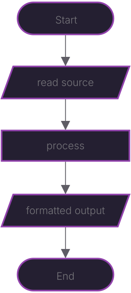

# Chisel Documentation

Chisel aims to be a simple code formatting tool.  Although it is primarily design to format **Lua**
code, it aims to become general enough to format any other language if a syntax and a set of rules
are provided.

This document is a language agnostic description of the problem and the proposed solution(s) to be
implemented in any programming language.


# Contents

- [The Problem](#the-problem)
    - [Knowing more about the problem](#know-more-about-the-problem)
- [The Plan](#the-plan)


# The Problem

We want to apply some formatting rules to some source code in some programming language.  Possible
scenarios are:

- Read a file and write formatted output to a file (possibly the same file).
- Read a string and give back a new string with the formatted output.

In both cases, the logic remains the same:

**INPUT**: string containing the source code.

**OUTPUT**: new string with the formatted source code.

Even if we want to _read from file_ and optionally _write to file_ or _read from stdin_ and output
to _stdout_, eventually we'll get a string and give back a string.  The _reading_ and _writing_ part
just surrounds our main algorithm.


## Knowing more about the problem

Formatting is basically just adding, removing or changing white space.  By the most part _space_ "\\
", _tabs_ "\\t" and _line feed_ "\\n" (sometimes referred to as "newline" character).  Although
other white space characters do exist, I have never encountered them in source code.

Anyway, for the purpose of solving this particular problem, I think we'll manage with those.

So, we need a way to read the text and know where to put, remove or replace white space.  To begin
with, we'll need two things:

- A way to identify individual "atoms" in the source code and know their semantics.
- A set of rules for placing white space around those "atoms".

An "atom" is a string of characters that can not be decomposed any further.  I.e, in **Lua** "local"
is an _atom_ but "table.insert" is not.  "a + b" (or "a+b") is composed of three _atoms_: "a", "+"
and "b" and "table.insert" is also made up from three _atoms_: "table", "." and "insert" (a _name_,
an _operator_ and a _field/method_ in this case).

In Computer Science and programming is common to call this "atoms" _tokens_, so I'll follow that
convention from now on.

Each token has a particular meaning or _semantics_.  We're going to rely on this to say _how do we
want our code to look like_ without changing it's meaning.

From now on, when we talk about _source code_ I'll assume valid _Lua code_.  Still, we'll strive to
provide a generic enough solution to extend later on to support other languages.  So **Lua** it is.

For the most part (assuming the code is valid _(this is **not** a linting tool)_) white space
doesn't change the semantics of the code.  But it can dramatically improve our code's _readability_.

A few examples:

```lua
local function point:move (x,y)  -- Valid, but ugly.
    --
end

local function point:move(x, y)  -- A lot better!
    --
end

```

```lua
local x=21*2      -- Seriously?

local x = 21 * 2  -- Now we're talking.

```

What "looks good" and "reads well" is somehow subjective and ultimately a matter of personal taste
(the computer doesn't care about it).  Yet it becomes crucially important when it comes to
maintaining the code.  You may not care about how the code looks _now_, but eventually it will
become more and more important as the time passes and/or the codebase grows.

For that matter, I found several styles pleasing to the eyes i.e.:

```lua
function do(a, b, c)       -- Looks nice to me.
    --
end

function do (a, b, c)      -- It's alright.
    --
end

function do ( a, b, c )    -- It's starting to get on my nerves ...
    --
end

function do ( a , b , c )  -- Nop ...
    --                     -- (Although I must admit it reads quite well ...)
end
```

So when it comes to apply the formatting, we may choose something that's not exactly what we want
but may be easier to implement in the beginning.  Later on we can tackle more complex rules and
refine the implementation further.


# The Plan

Let's start with a simple solution to try out some ideas and get to know the problem a little bit
better.  I'm going to keep things as simple as I can.

Our basic algorithm should look like this:


